<div align="center">

# FPGA-Based Edge-AI Vision Accelerator for N×N CNN Convolution

**ARA Silicon · Ain Shams University · IEEE SSCS Egypt Chapter, 2026 Student Design Competition**


[](https://github.com/AshrafByte/fpga-cnn-accelerator/actions/workflows/ci.yaml)

A streaming, fully parameterized N×N convolution accelerator in SystemVerilog, implemented on the
AMD Zynq-7020 (PYNQ-Z2), verified bit-exact against an independent Python golden model and
demonstrated on the board.

[Report (PDF)](docs/report/report.pdf) · [Slides (PDF)](docs/presentation/slides.pdf) ·
[FPGA flow](fpga/README.md) · [Golden model](sw/README.md) · [Experiments](experiments/README.md)

</div>

---

## Contents

1. [Highlights](#1-highlights)
2. [Repository guide](#2-repository-guide)
3. [Design](#3-design)
4. [Waveforms](#4-waveforms)
5. [FPGA implementation](#5-fpga-implementation)
6. [Verification](#6-verification)
7. [Board demonstration](#7-board-demonstration)
8. [Design space exploration](#8-design-space-exploration)
9. [Usage](#9-usage)
10. [Documentation and team](#10-documentation-and-team)

---

## 1. Highlights

Competition build: 3×3 kernel, 32×32 image, one kernel, no ReLU, 250 MHz, routed in Vivado 2018.2.

| LUT | FF | DSP | BRAM | LUT + 50·DSP + 100·BRAM | Fmax | Power | FoM | Throughput |
|:---:|:---:|:---:|:---:|:---:|:---:|:---:|:---:|:---:|
| **78** | 521 | **9** | **0** | **528** | **305.6 MHz** | 110.6 mW | **0.01712** | 1 px / cycle |

FoM = Throughput / (Power × (LUT + 50·DSP + 100·BRAM)): 0.01712 on checkerboard + Sobel-Y,
0.01579 on bars + Sobel-X (SAIF power of the routed design).

- **All arithmetic in DSP48E1 slices.** One PCOUT→PCIN cascade computes the 3×3 window sum with 2 LUTs.
- **Three MAC architectures, selected at elaboration** from kernel size N and kernel count K:
  single DSP cascade, row DSP chains, multiplier array + pipelined adder tree.
- **Streaming without reset.** Frames follow each other back to back; `o_frame_done` marks the last
  feature of every frame, and a new kernel can be loaded between frames.
- **One output pixel per clock cycle** through a prefill FIFO that hides the row-edge gaps.
- **All five bonus features:** ReLU, one pixel per cycle, multiple kernels, FPGA board demo, edge detection.
- **Verified bit-exact:** 62 regression cases (307 328 features, 0 mismatches) and 40 SystemVerilog
  configurations × 11 tests.

The design principle follows the FoM: flip-flops are free, a DSP costs 50 LUTs and a BRAM 100, so
additions go into DSP slices, storage into shift registers and flip-flops, and no BRAM is used.

---

## 2. Repository guide

```
fpga-cnn-accelerator/
├── hw/                          RTL and testbenches (the design)
│   ├── ip/<module>/src/rtl/     one folder per building block, with src/tb unit testbenches
│   │   line_buffer  window_generator  kernel_register  mac_single_chain  mac_row_chain
│   │   multiplier_array  adder_tree  round_saturate  relu_unit  output_fifo
│   └── system/conv_system/
│       ├── src/rtl/conv_system.sv      top level: parameters, MAC selection, lanes, frame protocol
│       ├── src/tb/conv_system_tb.sv    self-checking testbench (internal reference model)
│       ├── src/tb/conv_image_tb.sv     file-driven testbench used by the Python golden model
│       └── sim/                        compile.f / rtl.f / tb.f file lists and run.do
├── common/                      shared SystemVerilog packages and modules, script/vrun.py runner
├── sw/                          conv_lab: golden model, image/kernel tools, CLI, hardware regression
├── fpga/                        Vivado flow, constraints, reports, PYNQ-Z2 overlay and board demo
│   ├── scripts/  constraints/  sim/        synth, impl, power + FoM, bitstream, board_sim
│   ├── synth/ impl/ reports/               routed results of the competition build (default)
│   ├── bitstream/                          conv_demo.bit + conv_demo.hwh (PYNQ overlay)
│   └── board/                              AXI4-Lite wrapper, its testbench, PYNQ driver + notebook
├── experiments/                 standalone MAC architectures, rounding variants, 160 MHz sweep
├── verif/                       UVM environment template and shared verification components
├── docs/
│   ├── report/                  Typst report (report.pdf), figures, figure scripts (Python, MATLAB)
│   ├── presentation/            Typst slides (slides.pdf)
│   ├── resources/diagrams/      draw.io sources of every block diagram
│   └── spec/                    competition announcement
├── .github/workflows/ci.yaml    lint on pushes to hw/, common/ and verif/
└── Makefile                     make sim / verify / fpga targets
```

| To learn about | Read |
|---|---|
| The RTL of one block | `hw/ip/<module>/src/rtl/<module>.sv` (every file starts with a design header) |
| The top level and MAC selection | `hw/system/conv_system/src/rtl/conv_system.sv` |
| Vivado flow, arguments, register map, board | [fpga/README.md](fpga/README.md) |
| Golden model, CLI, file contract, regression | [sw/README.md](sw/README.md) |
| Architecture comparison and sweep | [experiments/README.md](experiments/README.md) |
| Everything, with analysis and numbers | [docs/report/report.pdf](docs/report/report.pdf) |

---

## 3. Design

### 3.1 Top level

<p align="center">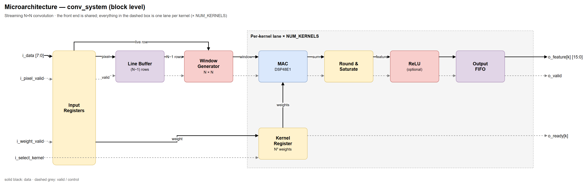</p>

Pixels arrive in raster order. A shared front end (input registers, line buffer, window) feeds one
**lane per kernel**: kernel register, MAC, round and saturate, optional ReLU and output FIFO. Every
stage forwards a valid bit; there is no central FSM register, and when `i_pixel_valid` drops every
counter and shift register simply holds.

<p align="center">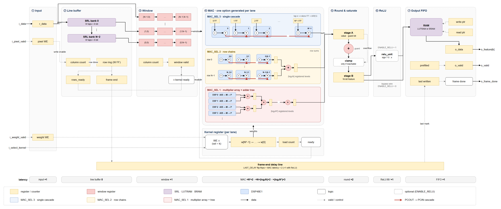</p>

### 3.2 Interface and parameters

| Port | Dir | Width | Description |
|---|---|---|---|
| `clk`, `rst_n` | in | 1 | clock; active-low asynchronous reset (power-up or abandoned frame) |
| `i_data` | in | 8 | pixel (unsigned) or weight (signed), shared bus |
| `i_pixel_valid` | in | 1 | `i_data` is the next pixel in raster order; may stall |
| `i_weight_valid` | in | 1 | `i_data` is the next weight of the selected kernel |
| `i_select_kernel` | in | ⌈log₂K⌉+1 | kernel lane loaded by weight writes |
| `o_feature[K]` | out | 16 each | signed output feature of every lane |
| `o_valid` | out | 1 | all lanes valid |
| `o_frame_done` | out | 1 | high with `o_valid` on the last feature of each frame |

**Protocol.** After reset, write N² weights per lane (each kernel row right to left, see the report
§4.3). Then send W² pixels per frame with any number of idle cycles; (W−N+1)² features come out, the
last with `o_frame_done`. The next frame follows without a reset, and a new kernel can be written
between frames.

| Parameter | Default | Meaning |
|---|---|---|
| `WINDOW_SIZE` | 3 | kernel size N |
| `INPUT_SIZE` | 32 | image width and height W |
| `NUM_KERNELS` | 1 | parallel kernel lanes K |
| `ENABLE_RELU` | 0 | insert `relu_unit` per lane |
| `MAC_ARCH` | 0 | 0 automatic, 1 tree, 2 row chains, 3 single cascade |
| `FIFO_RAM_MODE` | 0 | output FIFO memory: 0 automatic (by FoM cost), 1 LUTRAM, 2 BRAM |
| `CHAIN_MAX_N`, `ROW_CHAIN_MAX_N`, `ROW_CHAIN_MAX_DSP` | 3, 8, 180 | limits of the automatic MAC selection |

### 3.3 Line buffer, window and kernel register

<p align="center">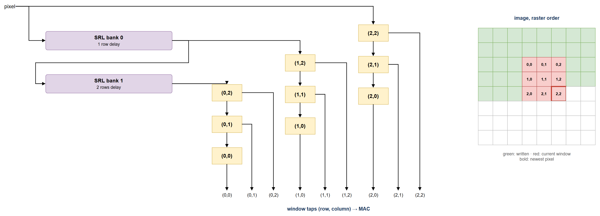</p>

- **`line_buffer`** keeps N−1 rows in shift-register LUTs (SRLC32E, 512 bits in 16 SRLs at 3×3/32);
  the live row is not stored. A column counter and a **one-hot row ring** of W flip-flops track the
  frame position without counter LUTs, raise `rows_ready` and mark the frame end. 22 LUTs.
- **`window_generator`** shifts the rows into an N×N register window and asserts `window_valid`
  once N−1 columns of the row are in (stride 1). 3 LUTs, 75 FFs.
- **`kernel_register`** is shift-loaded: every weight write shifts N² signed 8-bit weights by one,
  so there is no address decoder; a load counter raises `o_ready`. 5 LUTs.

### 3.4 Multiply-accumulate (MAC)

<p align="center">
  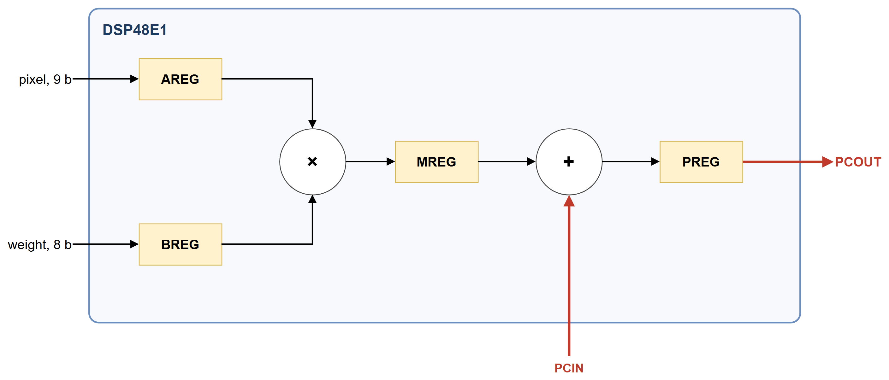
  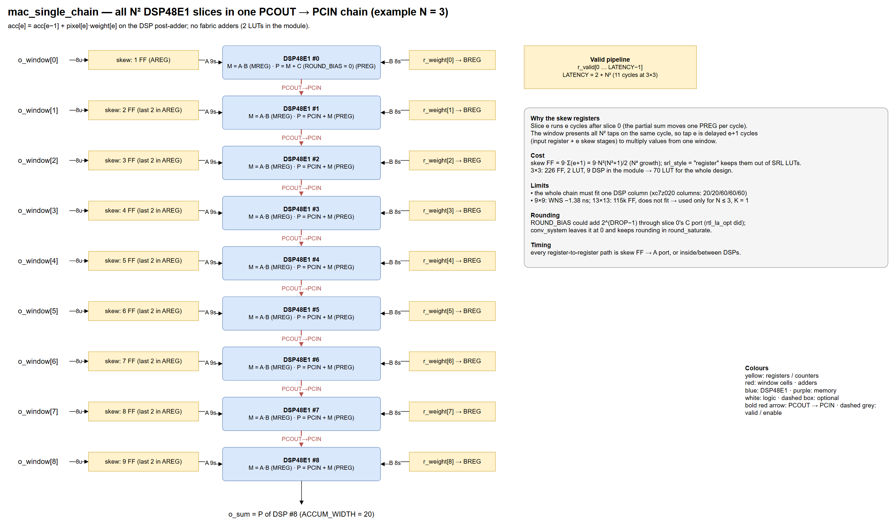
</p>

Every MAC uses one DSP48E1 per tap: pixel on port A (AREG), weight on B (BREG), product in MREG,
post-adder result in PREG. The **single cascade** chains all N² slices through PCOUT→PCIN, so slice e
computes acc<sub>e</sub> = acc<sub>e−1</sub> + p<sub>e</sub>·w<sub>e</sub> and no fabric adder is left
(2 LUTs). Tap e waits e+1 cycles in skew flip-flops; latency 2 + N² = 11 cycles.

<p align="center">
  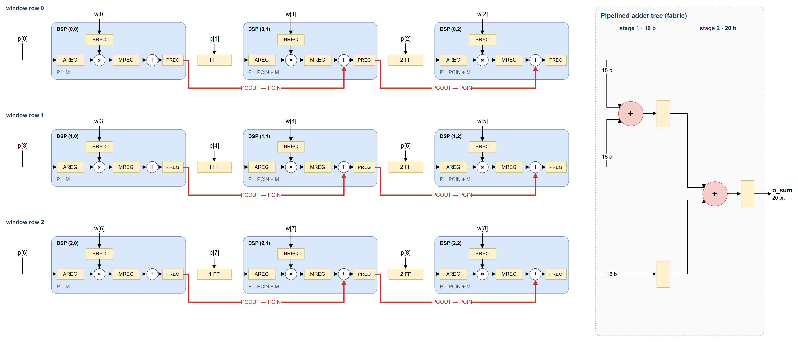
  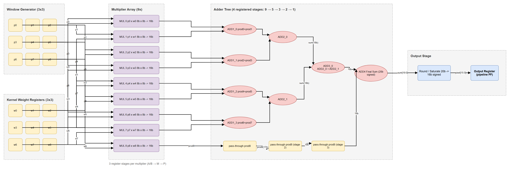
</p>

**Row chains** build one N-slice cascade per window row and reduce the row sums in a bit-growing
pipelined fabric tree (latency 2 + N + ⌈log₂N⌉). The **multiplier array + tree** computes all
products in parallel DSPs and sums them in a ⌈log₂N²⌉-level registered tree (latency 3 + ⌈log₂N²⌉);
it is the only architecture whose multipliers can move into LUTs.

<p align="center">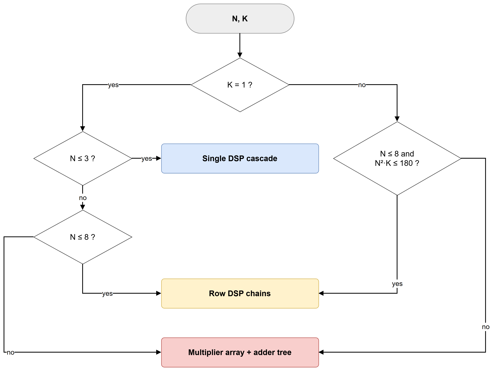</p>

| Kernels | Condition | Architecture |
|---|---|---|
| K = 1 | N ≤ 3 | single DSP cascade |
| K = 1 | 4 ≤ N ≤ 8 | row chains |
| K = 1 | N ≥ 9 | multiplier array + tree |
| K ≥ 2 | 2 ≤ N ≤ 8 and N²·K ≤ 180 | row chains |
| K ≥ 2 | otherwise | multiplier array + tree |

### 3.5 Fixed point, rounding and saturation

| Signal | Type | Width | Range (3×3) |
|---|---|---|---|
| pixel | unsigned | 8 | 0 … 255 |
| weight | signed | 8 | −128 … 127 |
| product | signed | 16 | −32 640 … 32 385 |
| accumulator | signed | 16 + ⌈log₂N²⌉ = 20 | −293 760 … 291 465 |
| output feature | signed | 16 | reachable −18 360 … 18 217 |

<p align="center">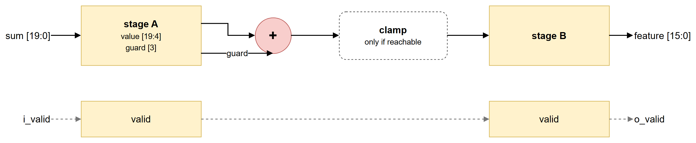</p>

- **Round half up:** y = ⌊(x + 2<sup>DROP−1</sup>) / 2<sup>DROP</sup>⌋ = truncated value + guard bit,
  with DROP = ⌈log₂N²⌉. Same RMS error as round-half-to-even (0.29 LSB), 3 LUTs instead of 20,
  +3.3 % FoM.
- **No saturation needed:** because DROP grows with the window, |y| ≤ 255·128 = 32 640 for every N.
  The clamp is generated at elaboration only if the widths make overflow reachable; building it
  anyway would cost 21 LUTs and 10 % FoM.

<p align="center">
  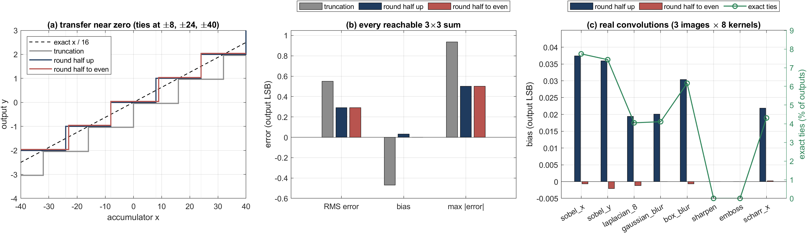
</p>

### 3.6 ReLU, output FIFO and frame protocol

<p align="center">
  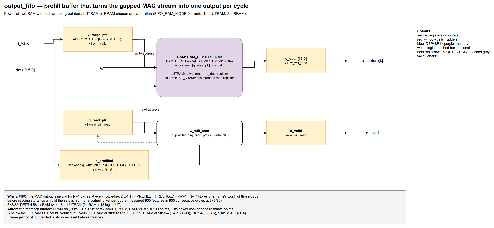
  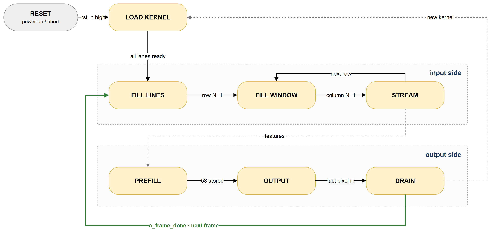
</p>

- **`relu_unit`** (with `ENABLE_RELU = 1`) is one register stage after rounding that outputs 0 for a
  negative feature; after rounding it is exact and only 16 bits wide.
- **`output_fifo`** stores (W−N)(N−1) = 58 features before it starts reading, exactly one frame's
  row-edge gaps, so `o_valid` then stays high: one feature per clock cycle. The memory (LUTRAM or
  BRAM) is chosen by FoM cost at elaboration; 24 LUTRAMs here.
- **Frames without reset:** the line buffer marks the frame's last window, a flip-flop delay line
  of `LAST_DELAY` stages (13 at 3×3) carries the mark to the FIFO, `o_frame_done` rises with the last
  feature, and a registered clear re-arms the FIFO. Cost: 7 LUTs.

| Stage | Latency (cycles) |
|---|---|
| input registers | 1 |
| line buffer / window | 0 / 1 |
| MAC (single cascade) | 2 + N² = 11 |
| round and saturate | 2 |
| ReLU | 0 (1 when enabled) |
| FIFO | 1 (after the 58-feature prefill) |
| **pixel pipeline depth** | **16** |

32×32 frame: first feature 142 cycles after the first pixel, last feature after 1041 cycles, then
900 features in 900 consecutive cycles.

---

## 4. Waveforms

QuestaSim (`docs/report/scripts/waveform.py`, 8×8 frames so every phase is readable):

<p align="center">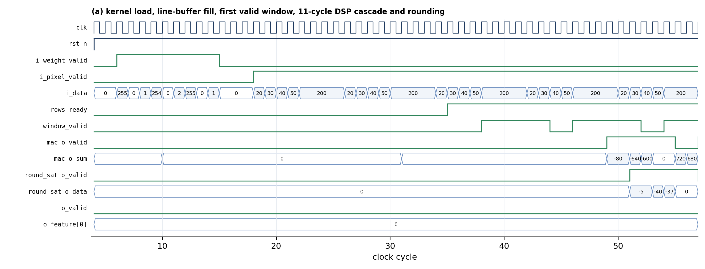</p>

*(a) Weights shift in, pixels fill the line buffer, `window_valid` rises on the first complete window
and the cascade sum appears 11 cycles later, then rounding.*

<p align="center">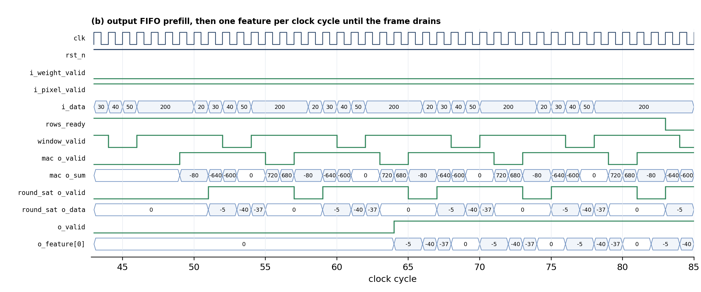</p>

*(b) Rounded features enter the FIFO with row-edge gaps; after the prefill `o_valid` stays high.*

<p align="center">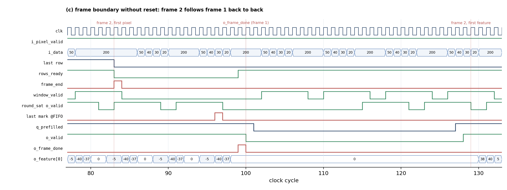</p>

*(c) Frame 2 follows frame 1 back to back: `rows_ready` falls on the last row, the frame-end mark reaches
the FIFO with the last feature, `o_frame_done` pulses and frame 2 prefills again, all without a reset.*

Vivado xsim, competition build (`docs/report/scripts/vivado_waves.py`):

<p align="center">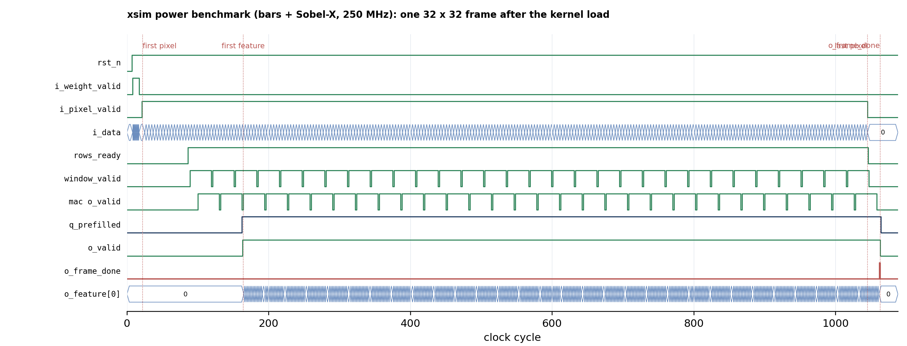</p>

*The power benchmark (bars + Sobel-X, 250 MHz): 1024 pixels in, 900 features out in 900 consecutive cycles.*

<p align="center">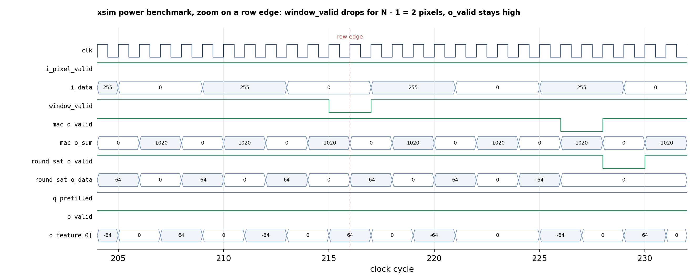</p>

*Zoom on a row edge: `window_valid` and the MAC valid drop for N−1 = 2 pixels while `o_valid` stays high.*

<p align="center">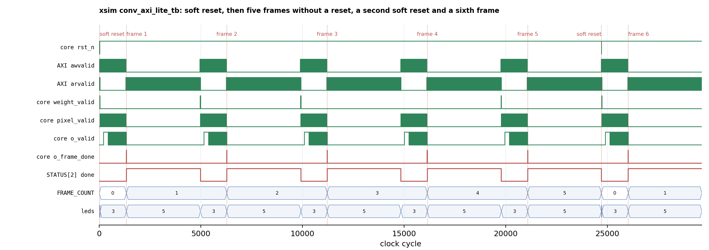</p>

*`conv_axi_lite_tb`: soft reset, five frames without a reset, a second soft reset and a sixth frame;
`STATUS[2]`, `FRAME_COUNT` and the LEDs follow every `o_frame_done`.*

<p align="center">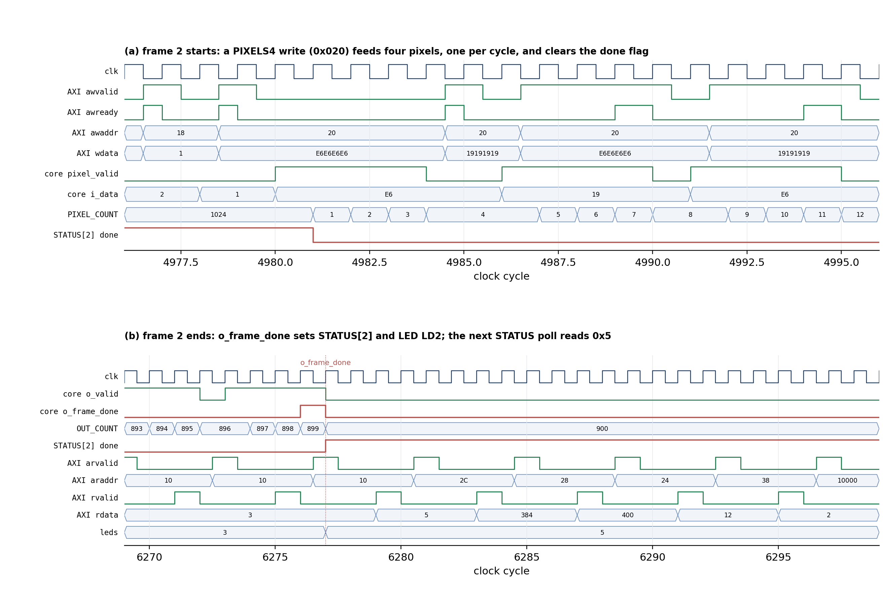</p>

*AXI detail: a `PIXELS4` write feeds four pixels on four cycles; `o_frame_done` sets `STATUS[2]` and LED LD2.*

---

## 5. FPGA implementation

**Flow** (`fpga/scripts`, non-project Vivado 2018.2, part `xc7z020clg400-1`): `synth_design` →
`opt_design`, `place_design`, `phys_opt_design`, `route_design` → utilization, timing, DRC, route
status → power with a SAIF of one full frame recorded in xsim → FoM → PYNQ-Z2 bitstream.

### 5.1 Results

| Resource | Used | Available | % |
|---|---:|---:|---:|
| LUT (logic 37, LUTRAM 24, SRL 17) | 78 | 53 200 | 0.15 |
| FF | 521 | 106 400 | 0.49 |
| DSP48E1 | 9 | 220 | 4.09 |
| BRAM | 0 | 140 | 0 |

| Module | LUT | FF | DSP |
|---|---:|---:|---:|
| `conv_system` (top, frame-end delay line) | 0 | 38 | 0 |
| `line_buffer` | 22 | 39 | 0 |
| `window_generator` | 3 | 75 | 0 |
| `kernel_register` | 5 | 76 | 0 |
| `mac_single_chain` | 2 | 226 | 9 |
| `round_saturate` | 3 | 35 | 0 |
| `output_fifo` | 43 | 32 | 0 |

| Timing @ 4.000 ns | Value |
|---|---|
| WNS / TNS | +0.728 ns / 0.000 ns |
| WHS | +0.082 ns |
| Fmax | 1 / (4.000 − 0.728) ns = **305.6 MHz** |
| Critical path | output FIFO read pointer → output data CE, 3.007 ns, 2 logic levels |

| Workload (SAIF) | Total | Dynamic | Device static | FoM |
|---|---:|---:|---:|---:|
| Checkerboard + Sobel-Y | 110.615 mW | 6.163 mW | 104.452 mW | **0.01712** |
| Bars + Sobel-X | 119.921 mW | 15.336 mW | 104.585 mW | 0.01579 |
| Vectorless (reference) | 159.860 mW | 54.699 mW | 105.161 mW | 0.01185 |

87–94 % of the power is device static, most of it the idle Zynq processing system.

<p align="center">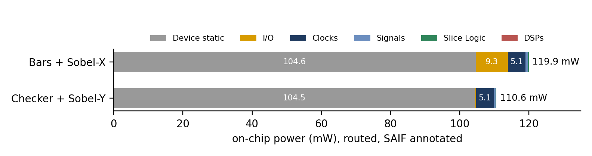</p>

### 5.2 Vivado screenshots

| | |
|:---:|:---:|
| 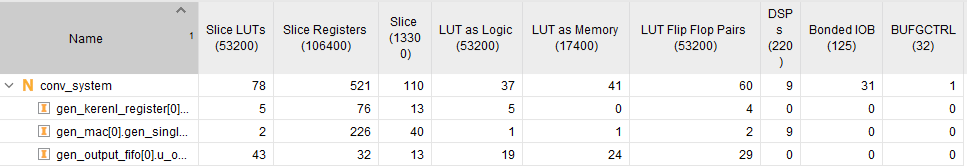 | 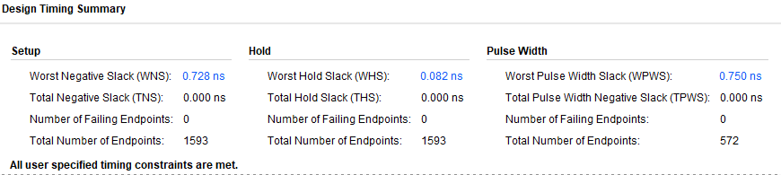 |
| Utilization by module | Design timing summary |
| 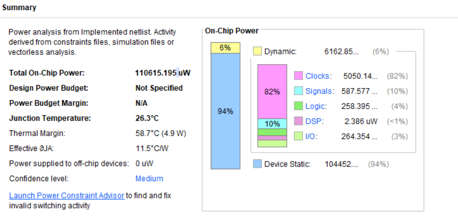 | 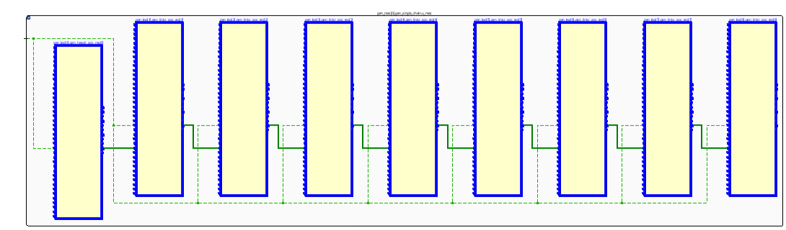 |
| Power summary (checker + Sobel-Y SAIF) | Schematic: nine DSP48E1 slices in one chain |

<p align="center">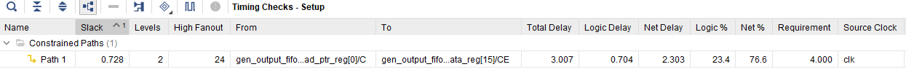</p>
<p align="center"><em>Worst setup path</em></p>

<p align="center">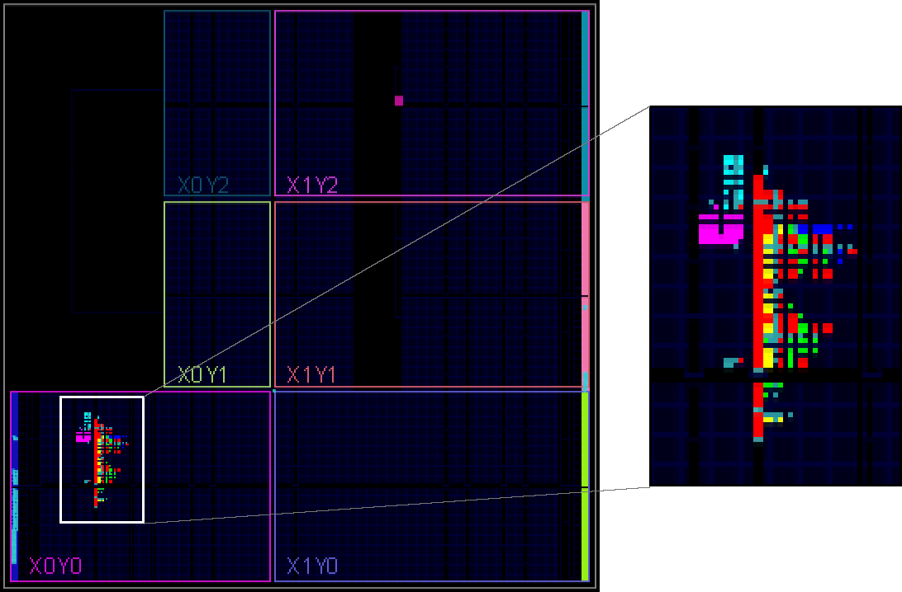</p>
<p align="center"><em>Device view: red MAC, blue line buffer, green window, magenta FIFO, yellow kernel register, cyan rounding</em></p>

More: [fpga/README.md](fpga/README.md), reports in `fpga/impl/default/` and `fpga/reports/default/summary.md`.

---

## 6. Verification

<p align="center">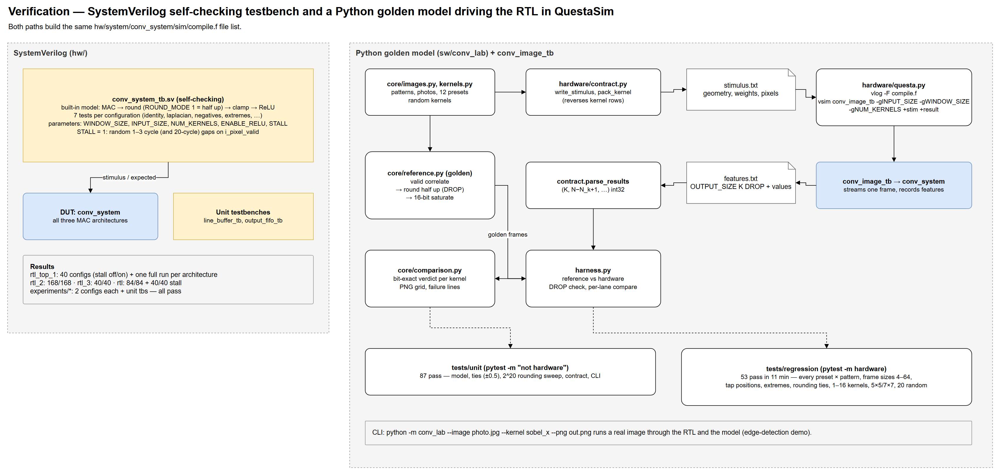</p>

Two references that share no code: a SystemVerilog model inside the self-checking testbench, and a
Python golden model that drives the same RTL through files.

### 6.1 SystemVerilog testbench

<p align="center">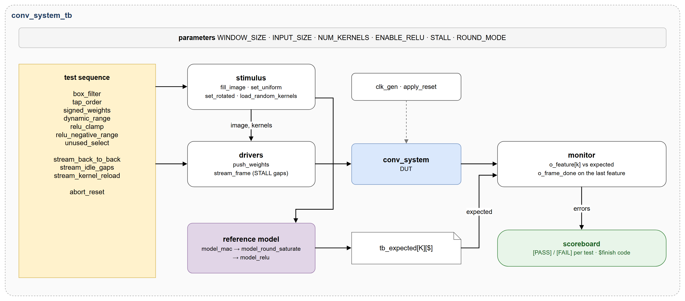</p>

`conv_system_tb` loads kernels, streams frames, and compares every feature of every lane and the
`o_frame_done` pulse against its model on every cycle. 11 tests: box filter, tap order, signed
weights, dynamic range, ReLU clamp, ReLU negative range, unused select, and four frame-protocol
tests (back to back, idle gaps, kernel reload between frames, abort with reset). `STALL = 1` inserts
random gaps in `i_pixel_valid`.

### 6.2 Verification software (`sw/conv_lab`)

<p align="center">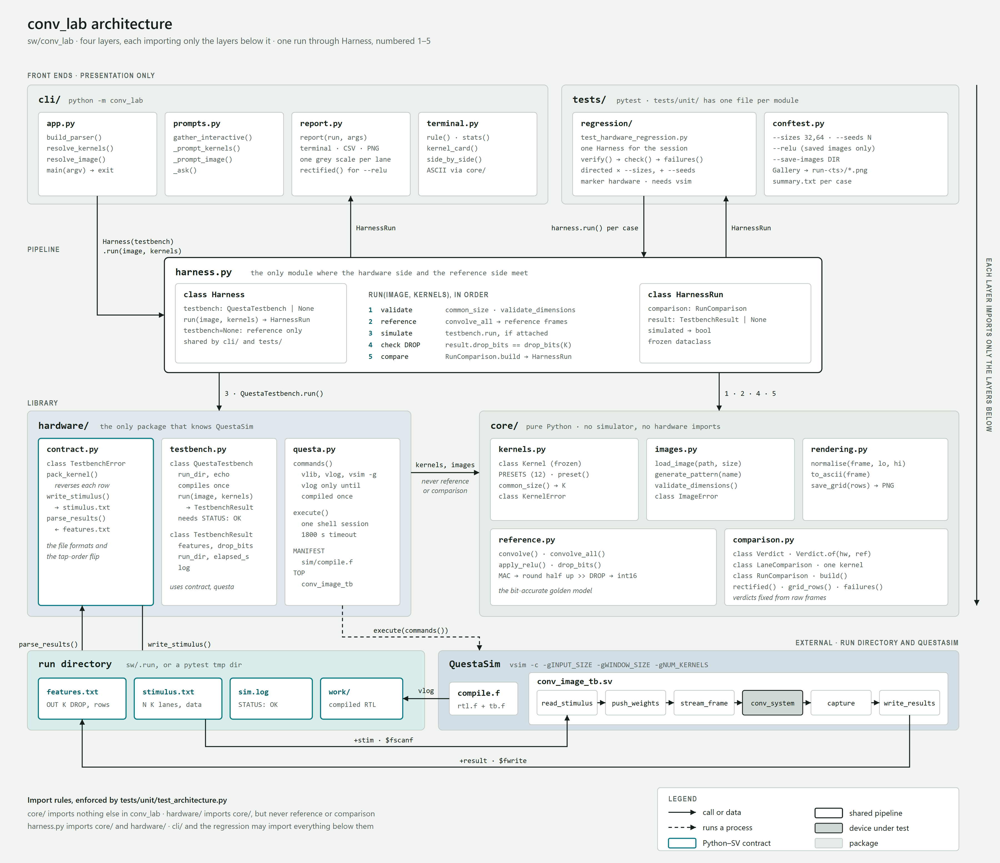</p>

Four layers; each imports only the layers before it (core → hardware → harness → cli):

| Layer | Modules | Role |
|---|---|---|
| `core/` | `reference.py`, `kernels.py`, `images.py`, `comparison.py`, `rendering.py` | bit-accurate golden model, 12 preset kernels, patterns (`ramp checker circle bars noise edges`), verdicts, images |
| `hardware/` | `contract.py`, `testbench.py`, `questa.py` | `stimulus.txt` / `features.txt` format, tap-order flip, QuestaSim commands |
| `harness.py` | `Harness` | the one pipeline where reference and hardware meet |
| `cli/`, `tests/` | CLI app, unit tests, `test_hardware_regression.py` | front ends on the same harness |

### 6.3 Results

| Level | What | Result |
|---|---|---|
| `conv_system_tb` | 40 configurations (N 2–11, W 4–64, K 1–16, ReLU, stall, all three MACs) × 11 tests | 40 / 40 |
| IP unit tests | line buffer, output FIFO, kernel register, round/saturate over all 2²⁰ inputs | pass |
| `conv_lab` unit tests | golden model, rounding ties, file contract, CLI, architecture rules, patterns | 100 / 100 |
| Hardware regression | presets on every pattern, frame sizes 4–64, every tap, extremes, round ties, 1–16 lanes, 5×5 and 7×7, random, 8 multi-frame streams | 62 cases, 307 328 features, **0 mismatches** |
| Board wrapper (xsim) | 3 builds × 6 frames through AXI | all features bit-exact |
| Mutation check | three deliberate RTL bugs | 3 / 3 caught |

<p align="center">
  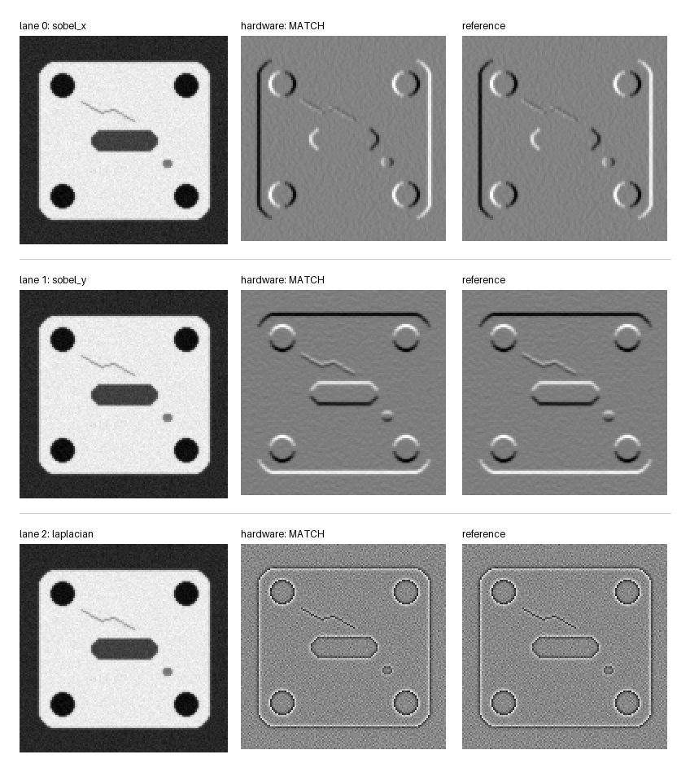
  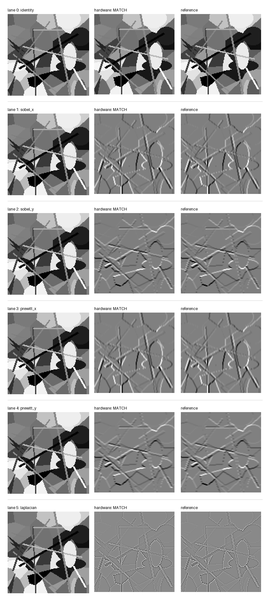
</p>
<p align="center"><em>Input | RTL in QuestaSim | golden model: 128×128 inspection image and the <code>edges</code> pattern through the preset kernels</em></p>

More: [sw/README.md](sw/README.md), the testbench headers in `hw/system/conv_system/src/tb/`, and
`docs/report/figures/verif/regression_summary.txt`.

---

## 7. Board demonstration

<p align="center">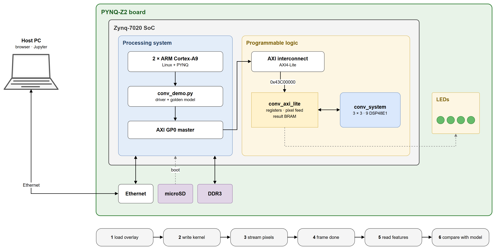</p>

`conv_axi_lite` (in `fpga/board/rtl`) puts `conv_system` behind an AXI4-Lite slave at `0x43C00000`
on the Zynq GP0 bus: kernel and pixel writes (`PIXELS4` carries four pixels per write), a block-RAM
result memory per lane, status and counter registers, and four LEDs (weights loaded, streaming,
frame done, heartbeat). Overlay: 813 LUT, 9 DSP, 0.5 BRAM, WNS +2.560 ns at 100 MHz.

| Offset | Register | Content |
|---|---|---|
| 0x000 / 0x004 | ID / GEOMETRY | `CNV1`; W, N, K |
| 0x00C / 0x010 | CTRL / STATUS | soft reset; weights loaded, streaming, frame done |
| 0x014 / 0x018 | KERNEL_SEL / WEIGHT | lane; next weight |
| 0x01C / 0x020 | PIXEL / PIXELS4 | one pixel; four pixels |
| 0x024 … 0x038 | counters | weights, pixels, features, latency, frame cycles, frame count |
| 0x10000 + … | features | int16 result memory per lane |

`fpga/board/pynq/conv_demo.py` and `conv_demo.ipynb` reset once, load kernels (only when they change),
stream frames without a reset, read the features back and compare every frame with the golden model.
Full register map and steps: [fpga/README.md](fpga/README.md#board-demonstration-pynq-z2).

---

## 8. Design space exploration

A 35-build sweep of the three MAC architectures (N = 2…17, one kernel, 32×32, 160 MHz, SAIF power)
explains why the design contains all three:

<p align="center">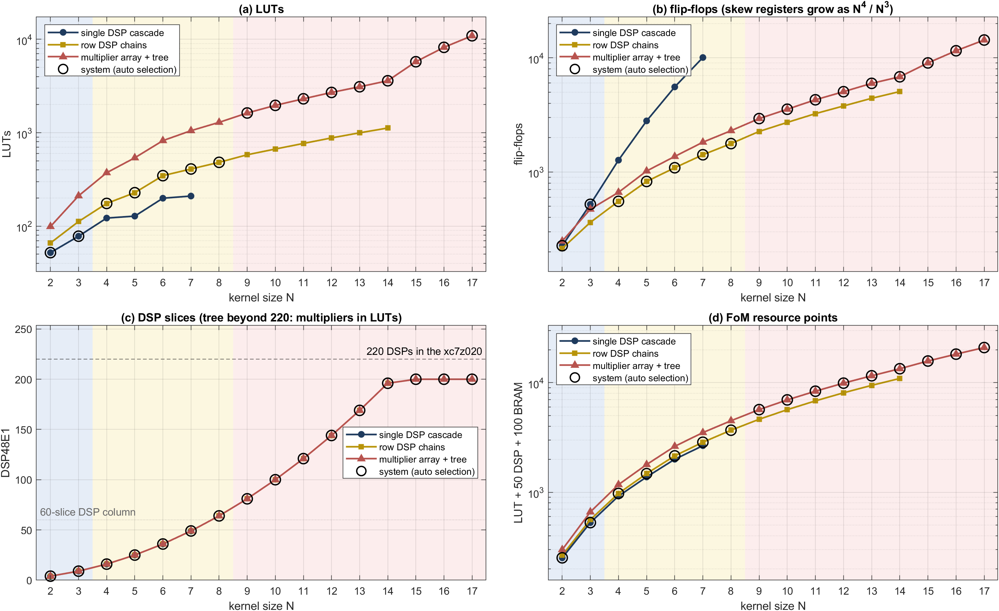</p>
<p align="center">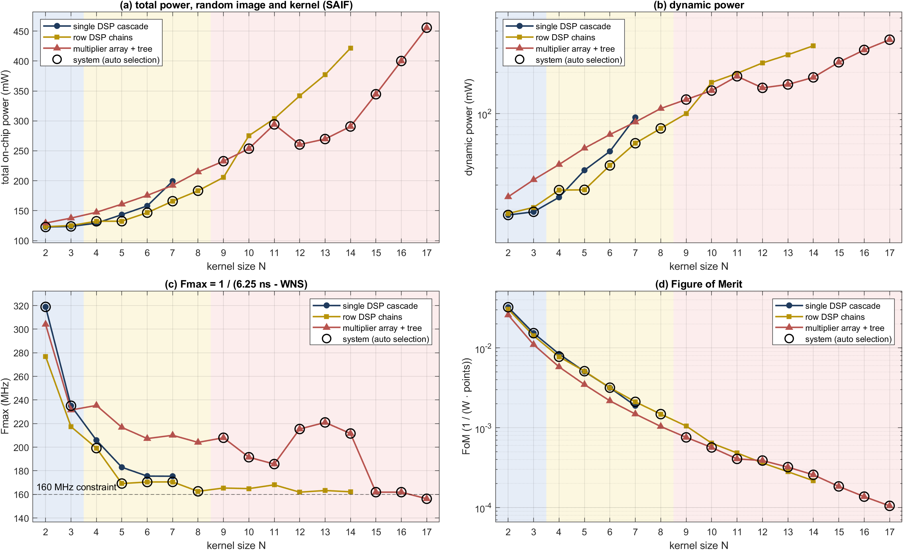</p>

| Architecture | Skew flip-flops | Limit on the xc7z020 | Best FoM at 160 MHz |
|---|---|---|---|
| Single DSP cascade | ∝ N⁴ | one 60-slice DSP column (N ≤ 7) | N ≤ 4 |
| Row DSP chains | ∝ N³ | 220 DSPs (N ≤ 14) | N = 5…11 |
| Multiplier array + tree | none | multipliers spill into LUTs (to 17×17) | N ≥ 12 |

At the 3×3 competition point the single cascade wins (FoM 0.01731 vs 0.01612 row chains vs 0.01227
tree, checker + Sobel-Y, measured on the single-frame builds before the frame protocol). Earlier explorations (fabric multipliers, DSP multi-pumping, Double-MAC packing, clock-enable
gating, LUTRAM line buffer) are compared in the report, §13.

More: [experiments/README.md](experiments/README.md) and `experiments/sweep/results.csv`.

---

## 9. Usage

### 9.1 Requirements

| Tool | Used for |
|---|---|
| QuestaSim (`vlib`, `vlog`, `vsim` on `PATH`) | RTL simulation and the hardware regression |
| Python 3.11+ with `numpy`, `pillow`, `pytest` | golden model, regression, CLI, board driver test |
| Vivado 2018.2 | synthesis, implementation, power, bitstream, xsim |
| Typst | report and slides (optional) |
| MATLAB | rounding and sweep charts (optional) |

### 9.2 RTL simulation

```bash
python common/script/vrun.py list                     # simulatable IPs and systems
python common/script/vrun.py sim conv_system          # self-checking system testbench
python common/script/vrun.py sim line_buffer          # IP tests: line_buffer, output_fifo, kernel_register
```

In the QuestaSim GUI, from `hw/system/conv_system/sim`:

```tcl
vlib work
vlog -sv -timescale 1ns/1ps -work work -f compile.f
vsim -voptargs=+acc -gWINDOW_SIZE=5 -gNUM_KERNELS=2 -gENABLE_RELU=1 -gSTALL=1 work.conv_system_tb
add wave -r /conv_system_tb/u_dut/*
run -all
```

`do run.do` does the same with the default parameters and saves `run.log`.

### 9.3 Golden model, CLI and regression

```bash
cd sw
python -m pip install numpy pillow pytest
python -m conv_lab                                                        # interactive
python -m conv_lab --list-kernels
python -m conv_lab --image photo.jpg --size 64 --kernel sobel_x --png compare.png
python -m conv_lab --pattern edges --size 128 --kernel sobel_x --kernel sobel_y --kernel laplacian --png edges.png
python -m conv_lab --pattern checker --size 128 --kernel sobel_x --relu --png relu.png
python -m conv_lab --image photo.jpg --size 64 --kernel sharpen --reference     # model only, no simulator

python -m pytest tests -m "not hardware"                                   # unit tests
python -m pytest tests -m hardware                                         # hardware regression
python -m pytest tests -m hardware --sizes 16,32,64 --seeds 200 --save-images regression_results
```

Keep `tests` in the pytest commands: `--sizes`, `--seeds`, `--relu` and `--save-images` are defined in
`sw/tests/conftest.py`. Every CLI run simulates the frame on `conv_image_tb` and checks it against the
golden model; the exit code is 0 only when every feature matches.

### 9.4 FPGA flow and FoM

```powershell
.\fpga\run.ps1                                  # synth, impl, power + FoM, PYNQ-Z2 bitstream
.\fpga\run.ps1 -Steps synth,impl,power          # FoM only -> fpga/reports/default/summary.md
.\fpga\run.ps1 -Steps synth,impl,power -N 5 -W 64 -K 2 -Relu 1 -Period 5.000
.\fpga\run.ps1 -Steps board_sim                 # AXI wrapper test in xsim (3 builds x 6 frames)
python -m pytest fpga/board/tests               # PYNQ driver against a register model (no board)
```

From the Vivado Tcl console (repository root):

```tcl
set argv {STEPS synth+impl+power N 3 W 32 K 1 RELU 0 PERIOD 4.000}
source fpga/scripts/run_all.tcl
```

After the flow has run, **File → Open Checkpoint** `fpga/impl/default/post_route.dcp` (checkpoints are
not in git) for the device view, schematic and reports. On Linux: `make fpga`, `make fpga-power FPGA_ARGS="N 5 W 64"`, `make fpga-board-sim`.

### 9.5 Architecture experiments

```bash
python experiments/sweep/run_sweep.py          # 160 MHz sweep, outputs in experiments/flow/build
vivado -mode batch -source experiments/flow/scripts/run_all.tcl -tclargs RTL conv_row_chain N 5
```

### 9.6 Board (PYNQ-Z2)

1. Boot the board with a PYNQ image (v2.4 or later) and open Jupyter at `http://<board>:9090`.
2. Copy `fpga/bitstream/conv_demo.bit`, `conv_demo.hwh`, `fpga/board/pynq/conv_demo.py` and
   `conv_demo.ipynb` into one folder.
3. Run the notebook, or `sudo python3 conv_demo.py --image photo.jpg --kernels sobel_x sobel_y --save edges.png`.

---

## 10. Documentation and team

| Document | Content |
|---|---|
| [docs/report/report.pdf](docs/report/report.pdf) | full report: specification, architecture, memory, datapath, fixed point, control, RTL, verification, FPGA results, FoM, bonuses, exploration |
| [docs/presentation/slides.pdf](docs/presentation/slides.pdf) | short presentation |
| [fpga/README.md](fpga/README.md) | Vivado flow, arguments, results, register map, board demo |
| [sw/README.md](sw/README.md) | `conv_lab` usage, file contract with the testbench, regression cases |
| [experiments/README.md](experiments/README.md) | MAC architecture builds, rounding variants, sweep results |

**ARA Silicon**, Ain Shams University

| Member | Program | GitHub |
|---|---|---|
| Ahmed Ashraf | Computer Engineering, Graduate | [@AshrafByte](https://github.com/AshrafByte) |
| Rana Ayman | Computer Engineering, Graduate | [@RanaAyman54](https://github.com/RanaAyman54) |
| Ammar Ahmed | Electronics & Communications, Year 4 | [@Ammar-Wahidi](https://github.com/Ammar-Wahidi) |
