# conv_lab

Pick an image, pick a kernel, run the convolution **on the SystemVerilog
testbench**, and see the hardware's output next to the Python reference
model's — both from one run, checked bit for bit.

```
image (N x N uint8) ─┐
                     ├─► stimulus.txt ─► conv_image_tb ─► features.txt ─► side by side
kernel(s) ───────────┘                   (conv_system)                    + MATCH / MISMATCH
```

## Install

```bash
cd sw
uv sync                                   # numpy, pillow, and pytest from the dev group
python -m pip install numpy pillow pytest # or the same without uv
```

Plus QuestaSim, with `vlib`/`vlog`/`vsim` on `PATH`. It is the only supported
simulator. Without it, `--reference` shows the model alone and the hardware
regression skips itself.

## Use

```bash
cd sw
python -m conv_lab                                    # interactive
python -m conv_lab --list-kernels                     # what's available
python -m conv_lab --image photo.jpg --size 64 --kernel sobel_x --png compare.png
python -m conv_lab --pattern circle --size 32 --kernel sobel_x --kernel sobel_y
python -m conv_lab --pattern ramp --size 16 --weights '1 0 -1; 2 0 -2; 1 0 -1'
python -m conv_lab --pattern checker --size 32 --kernel laplacian --png out.png --csv out.csv
python -m conv_lab --image photo.jpg --size 64 --kernel sharpen --reference   # no simulator
```

Any image format Pillow reads is accepted; it is converted to a single channel
and resized to `--size` x `--size`. `--pattern` substitutes a synthetic frame
(`ramp`, `checker`, `circle`, `bars`, `noise`) when the point is the hardware
rather than the picture.

Kernels come from `--kernel` (presets), `--weights` (custom), or both, and
repeating either flag loads several lanes into one run — the hardware evaluates
them in parallel, so five kernels cost the same simulated time as one. Custom
weights accept whatever you paste:

```
1 0 -1; 2 0 -2; 1 0 -1
[[1, 0, -1], [2, 0, -2], [1, 0, -1]]
```

Exit status is 0 when every feature matched the model, 1 when the hardware
disagreed or the simulator failed, 2 for bad input.

## One run, both results

Every default run simulates the frame on `conv_image_tb` **and** computes it
with the reference model, then puts them side by side. Per kernel you get the
stats for both, a `MATCH`/`MISMATCH` verdict, and an ASCII
`input | hardware | reference` preview; the run exits non-zero if any kernel
disagrees. `--png` writes the same comparison as an image, one row per kernel,
with each hardware label carrying its verdict. `--csv` writes one file per
kernel and source.

Hardware and reference are drawn on one grey scale, and the reference sets it:
it is the known-good frame. A corrupted hardware frame therefore cannot change
how the reference looks — its out-of-range values clip to black or white
instead, which makes them easy to spot. Only a flat reference borrows the
combined range, so hardware that differs from it still shows.

`--reference` skips the simulator and shows the model alone: same arithmetic,
same geometry rules, but no evidence that the RTL agrees, so no verdict is
printed. Use it when Questa is not available.

## ReLU

`--relu` applies `max(0, x)` to the output, as the activation after a CNN
convolution layer would:

```bash
python -m conv_lab --pattern circle --size 32 --kernel sobel_x --reference --relu
```

```
without --relu:   min  -48   max  48   nonzero 160/900
with    --relu:   min    0   max  48   nonzero  80/900
```

Exactly half the responses survive, because `sobel_x` on a symmetric shape
produces a matched negative for every positive — the dark side of each edge is
what gets zeroed.

**ReLU is not part of the hardware.** `conv_system` has no activation stage; its
feature bus is signed precisely so a downstream stage can make this decision.
So on the testbench path the rectification happens *after* the hardware-vs-model
check, never before — otherwise a hardware value of −5 and a model value of −9
would both collapse to 0 and report `MATCH` on a broken DUT. The verdict always
runs on raw features, and the output says so. A test plants exactly that
disagreement and asserts it is still caught.

In the library it is a keyword on the model, off by default:

```python
reference.convolve(image, kernel)              # signed features
reference.convolve(image, kernel, relu=True)   # ... then max(0, x)
reference.apply_relu(features)                 # standalone
```

## Presets

| Kernel | Sum | Gain | Notes |
| --- | ---: | ---: | --- |
| `identity` | 16 | 1.000 | pass-through |
| `sobel_x` / `sobel_y` | 0 | — | gradient, vertical / horizontal edges |
| `prewitt_x` / `prewitt_y` | 0 | — | unweighted gradient |
| `scharr_x` | 0 | — | better rotational symmetry than Sobel |
| `laplacian` / `laplacian_8` | 0 | — | second derivative, 4- and 8-neighbour |
| `gaussian_blur` | 16 | 1.000 | unity gain, see below |
| `box_blur` | 9 | 0.562 | mean filter, comes out dim |
| `sharpen` | 16 | 1.000 | unsharp mask |
| `emboss` | 16 | 1.000 | directional relief |

**Why the weights are not normalised.** The weight bus is signed 8-bit, so
presets carry their integer form. The divide is supplied by the pipeline:
`round_saturate` drops `$clog2(K**2)` low bits, which is a built-in `>>4` for a
3x3 window. A kernel whose weights sum to 16 is therefore unity gain — which is
why `gaussian_blur` looks right and `box_blur` (sum 9) comes out at 9/16
brightness. `--list-kernels` prints the gain for each.

## Interface to the hardware

```python
from conv_lab import Harness, QuestaTestbench, load_image, preset

image   = load_image("photo.jpg", 64)            # (64, 64) uint8
kernels = [preset("sobel_x"), preset("sobel_y")]

harness = Harness(QuestaTestbench("sw/.run"))     # Harness() alone runs reference-only
run = harness.run(image, kernels)                 # reference model + one simulated frame

run.result.features                               # (2, 62, 62) int32 from the hardware
run.comparison.all_match                          # every feature bit-exact?
run.comparison.failures()                         # one line per disagreeing lane

frames = [load_image(p, 64) for p in ("a.png", "b.png", "c.png")]
runs = harness.run_stream(frames, kernels)        # one simulation, one reset, 3 frames back to back
runs = harness.run_stream(frames, kernels, gap=9) # ... or 9 idle cycles between frames
[r.comparison.all_match for r in runs]            # each frame checked on its own
```

`Harness.run()` is the run pipeline both front ends share. It validates the
inputs, computes the reference frames, simulates the frame when a testbench is
attached, and compares the two. The CLI adds flags and printing on top; the
regression adds fixtures and asserts. Neither re-implements a run, so a change to
what a run does reaches both.

`QuestaTestbench.run()` is the hardware contract underneath. It writes the
stimulus, elaborates `conv_system` for that exact shape, streams one frame and
parses the features back, raising `TestbenchError` if the simulator is missing,
the run fails, or the frame comes back short. An instance compiles the RTL on
its first run; later runs only re-elaborate.

`run_stream()` (on both `Harness` and `QuestaTestbench`) sends several frames
through one simulation after a single reset, the way `conv_system` streams video:
back to back by default, or `gap` idle cycles apart. It returns one result per
frame, each compared with its own reference, so a pipeline that failed to re-arm
at a frame boundary shows up in the frame it smeared. The testbench also fails
the run unless `o_frame_done` is high exactly on the last feature of every frame.

`RunComparison` holds a verdict per kernel, fixed from the raw frames at
construction; frames on a shared display scale; PNG rows; failure lines.
`rectified()` applies ReLU to what is shown and can never change a verdict.

| | |
| --- | --- |
| `image` | `(N, N)` `uint8`, square, `N > K`, `N <= 512` |
| `kernels` | one or more `Kernel`, all the same odd size, weights in `[-128, 127]` |
| returns | `HarnessRun`: `.comparison`, and `.result` (a `TestbenchResult`, `features` as `(len(kernels), N-K+1, N-K+1)` `int32`) or `None` without a testbench |

Output is **valid-only** — no padding, so an N x N frame gives (N-K+1) squared
features — and each value is already `MAC >> drop_bits` with round-half-up (ties toward +infinity).

### Files exchanged

Three text files, under `sw/.run/` by default (`--run-dir` to move it):

`stimulus.txt`, written by Python and read by `$fscanf`:

```
INPUT_SIZE WINDOW_SIZE NUM_KERNELS
<NUM_KERNELS * WINDOW_SIZE**2 signed weights, kernel-major>
<INPUT_SIZE**2 pixels 0..255, raster order>      one block per frame, as many frames as the stream has
```

`features.txt`, written by the testbench:

```
# comment
OUTPUT_SIZE NUM_KERNELS DROP NUM_FRAMES
<one raster line per output pixel, frame after frame, NUM_KERNELS signed values each>
```

A header without `NUM_FRAMES` is read as one frame.

`sim.log` — the simulator's combined output, kept for diagnosis.

Geometry cannot travel in the file: `INPUT_SIZE`, `WINDOW_SIZE` and
`NUM_KERNELS` size the DUT at elaboration, so they are passed to `vsim` as `-g`
overrides *and* repeated in the file header, which the testbench checks. A
forgotten override is a clear error rather than a silently truncated image.

The testbench is usable without Python:

```bash
vlib work
vlog -sv -timescale 1ns/1ps -F hw/system/conv_system/sim/compile.f
vsim -c -gINPUT_SIZE=32 work.conv_image_tb \
     +stim=stimulus.txt +result=features.txt -do "run -all; quit -f"
```

Run these from the directory holding `stimulus.txt` — the testbench opens the
plusarg paths relative to the simulator's working directory. Every frame in the
file streams after one reset, back to back; add `+gap=<cycles>` for idle cycles
between frames.

### The one trap: tap order

`window_generator` shifts each new pixel column in at index 0, so the flattened
window the multipliers see is row-ascending but **column-descending**:

```
window[kr*K + kc] == image[row + kr][col + (K-1-kc)]
```

Loading a kernel verbatim would compute a column-mirrored result. `pack_kernel`
reverses each row on the way into `stimulus.txt`, so the hardware computes the
correlation you actually drew. Everything above that function — presets, the
golden model, the display — is in natural row-major order.

This is the failure that hides: it is invisible on any symmetric kernel
(`box_blur`, `gaussian_blur`, `laplacian`) and only shows up as a sign flip on
`sobel_x`. `tests/unit/test_hardware.py` replays the DUT's indexing in Python and
asserts the flip is what turns it back into a correlation.

## What the check actually proves

Each run compares the hardware's frame against `reference.convolve`, an
independent model of MAC → round-half-up → saturate. The result is
`MATCH` only when every feature is bit-exact.

Worth knowing: the 16-bit saturation clamp is **unreachable** with this
parameterisation. `DROP` is `$clog2(K**2)`, so the worst case is
`255 * 128 * K**2 >> $clog2(K**2)`, at most `255 * 128 = 32640` — inside the
signed 16-bit range for every odd K. The clamp only starts earning its keep if
`PIXEL_WIDTH` or `FEATURE_WIDTH` changes.

## Regression

`tests/regression/test_hardware_regression.py` runs the testbench over many inputs and requires
every feature of every lane to match the reference model. It is marked
`hardware` and skips itself when `vsim` is not on `PATH`.

```bash
cd sw
python -m pytest -m hardware                # the regression: 33 directed + 20 random frames + 8 streams
python -m pytest -m hardware --seeds 200    # widen the random sweep
python -m pytest -m hardware --sizes 16,32,64   # run the size-independent cases at each size
python -m pytest -m hardware --relu         # rectify the saved images (verdicts stay raw)
python -m pytest -m hardware --save-images regression_results   # keep a PNG of every case
python -m pytest -m "not hardware"          # fast unit tests, no simulator
python -m pytest                            # everything
```

Each case is one simulation, so the suite spends them carefully: kernels travel
as parallel lanes (all twelve presets cost a single frame), and the RTL is
compiled once per session, so each case only re-elaborates for its own
geometry. Run it serially — the cases share one Questa work directory.

| Case | Frames | Targets |
| --- | ---: | --- |
| every preset on every pattern | 5 × sizes | all presets as 12 lanes, per synthetic pattern |
| frame size | 10 | 4 (smallest legal), 16/17 and 32/33 (line-buffer counter width), odd sizes |
| every tap position | 2 × sizes | 9 one-hot kernels at +16 and −128 — any tap-order bug shifts a lane |
| extreme pixels and weights | 4 × sizes | black, white, pixel checker, noise against all-127, all-−128, alternating |
| round-half-up ties | 1 | every pixel 0..255 through centre taps ±1, ±3, ±7 (positive and negative .5 ties) |
| lane count | 9 × sizes | `NUM_KERNELS` 1–16, across the select bus's width steps |
| window size | 2 × sizes | 5×5 and 7×7 (sizes too small for the window are skipped) |
| randomised | `--seeds` | random size, image, window and 1–6 kernels, reproducible from the seed in the test id |
| stream every pattern | 2 × sizes | the five patterns as consecutive frames after one reset, back to back and 5 cycles apart |
| stream window size | 2 × sizes | three frames through the 5×5 and 7×7 row-chain builds |
| stream randomised | 4 | random size (down to window + 1), 2–4 frames, gap 0/1/17 and 1–4 kernels |

When a case fails, its tmp directory keeps `stimulus.txt`, `features.txt`,
`sim.log` and `mismatch.png` (input | hardware | reference), and the
message names every failing lane with its first differing feature and both values.

`--save-images DIR` keeps every result, pass or fail, in a fresh
`DIR/run-<timestamp>/` folder per session:

- one PNG per case, a row per kernel: `lane: kernel | hardware: MATCH/MISMATCH |
  reference`, on the reference's grey scale, so wrong hardware values clip to
  black or white.
- `summary.txt`, listing every case with its status, geometry and image file,
  plus the disagreeing lanes for each failure.

Earlier runs are never overwritten, and the summary is rewritten after each case,
so it stays complete up to the last finished case if a run is interrupted. The
folder path is printed at the end of the run.

## Layout



The folders are the architecture. Each layer may only import the layers above it
in this list, and `tests/unit/test_architecture.py` fails the build if one does.

```
sw/
├── conv_lab/
│   ├── harness.py            Harness · the one run pipeline, where both sides meet
│   ├── core/                 pure Python, no simulator
│   │   ├── kernels.py        Kernel, PRESETS, common_size
│   │   ├── images.py         load_image, generate_pattern, validate_dimensions
│   │   ├── reference.py      the bit-accurate golden model
│   │   ├── comparison.py     RunComparison · verdicts fixed from raw frames
│   │   └── rendering.py      normalise, ASCII previews, PNG grids
│   ├── hardware/             the only package that knows QuestaSim
│   │   ├── testbench.py      QuestaTestbench · run directory, compile once
│   │   ├── contract.py       stimulus.txt / features.txt formats, tap-order flip
│   │   └── questa.py         vlib / vlog / vsim commands and the shell
│   └── cli/                  a front end: flags, prompts, printing
│       ├── app.py            argument parsing, main()
│       ├── prompts.py        the interactive flow
│       ├── report.py         HarnessRun → terminal, CSV, PNG
│       └── terminal.py       rules, kernel cards, stats, ASCII layout
└── tests/
    ├── conftest.py           --seeds, --save-images, the image gallery
    ├── unit/                 one file per module, plus test_architecture.py
    └── regression/           test_hardware_regression.py (marker: hardware)
```

| Layer | May import | Never imports |
| --- | --- | --- |
| `core` | nothing else in `conv_lab` | `hardware`, `harness`, `cli` |
| `hardware` | `core` | `core.reference`, `core.comparison`, `harness`, `cli` |
| `harness` | `core`, `hardware` | `cli` |
| `cli` | `core`, `hardware`, `harness` | — |

The hardware side and the reference side meet only in `harness.py`, and the
regression is a second front end on the same `Harness`.

```bash
cd sw
python -m pytest tests/unit          # fast, no simulator
python -m pytest -m hardware         # the hardware regression
```

The hardware half lives in
[`hw/system/conv_system/src/tb/conv_image_tb.sv`](../hw/system/conv_system/src/tb/conv_image_tb.sv),
compiled through `hw/system/conv_system/sim/compile.f` (via `tb.f`, alongside
the existing self-checking `conv_system_tb`, which is untouched). It is a pure
harness — no stimulus, no expectations of its own.

## First run on a new machine

**Run a non-default size first:**

```bash
python -m conv_lab --pattern circle --size 16 --kernel sobel_x --verbose
```

`conv_image_tb`'s parameters default to `INPUT_SIZE=32, WINDOW_SIZE=3,
NUM_KERNELS=1`. A 32x32 single-kernel run therefore still passes even if the
`-g` overrides are silently ignored, because the defaults happen to be right.
Size 16 makes a broken override fail loudly, with the testbench reporting the
exact mismatch it saw. Once that passes, the geometry path is proven and any
size works. Then run the full regression: `python -m pytest -m hardware`.
